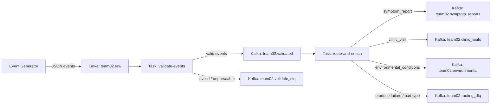

# Phase 1: Tekton Pipeline Implementation Plan

## Context

The repo is a scaffold with empty `tekton/`, `k8s/`, and `spark/` directories (only `.gitkeep` files). All Tekton manifests and documentation need to be created from scratch. The team number is **02**, so all topic names use `team02`.

**Kafka topics:**

- Input: `ds551-s26.team02.raw`
- Validated: `ds551-s26.team02.validated`
- Symptom reports: `ds551-s26.team02.symptom_reports`
- Clinic visits: `ds551-s26.team02.clinic_visits`
- Environmental: `ds551-s26.team02.environmental`
- **Validate dead letter:** `ds551-s26.team02.validate_dlq` — invalid or unparseable raw events (retained for inspection / replay)
- **Routing dead letter:** `ds551-s26.team02.routing_dlq` — validated events that fail produce, or have an unexpected `event_type` after validation

Ensure these topics exist in the cluster (same convention as other `team02` topics) before relying on them in production runs.

**Bootstrap server:** `my-cluster-kafka-bootstrap.ds551-2026-spring-9ab13b.svc.cluster.local:9092`

## Namespace Resource Quotas (Current Snapshot)

Plan deployment and run concurrency around current namespace limits:

| Resource | Used | Max | Practical headroom for this project |
|----------|------|-----|-------------------------------------|
| CPU (`limits.cpu`) | 2 | 4 | ~2 CPU available |
| Memory (`limits.memory`) | 4Gi | 8Gi | ~4Gi available |
| Ephemeral storage (`limits.ephemeral-storage`) | 0 | 5Gi | ~5Gi available |
| PVC storage requests (`requests.storage`) | 10Gi | 20Gi | ~10Gi available |
| PersistentVolumeClaims count | 2 | 2 | **0 available** (must free at least 1 PVC before adding new claims) |
| GPU (`requests.nvidia.com/gpu`) | 0 | 0 | No GPU capacity in this namespace |

### Pre-Deploy Resource Reclamation

Before applying Phase 1 manifests, free resources currently used by non-essential workloads for this project:

1. Identify pods/deployments/jobs from previous experiments and scale down or delete them.
2. Remove unused PVCs and stale volume claims to open at least one PVC slot (quota is currently full).
3. Verify quota headroom with `oc describe resourcequota` and ensure CPU/memory headroom remains before starting a `PipelineRun`.
4. Run Tekton workloads sequentially at first (single `PipelineRun`), then increase parallelism only after confirming stable quota usage.

---

## Data Flow

---

## Reliability (addresses Bistro-style gaps)

| Risk | Mitigation in this plan |
|------|-------------------------|
| **Retry-missing** | Set **PipelineTask `retries`** (e.g. `2`–`3`) on both `validate` and `route-and-enrich` in `pipeline.yaml` so transient pod/network/Kafka failures re-run the task before failing the whole `PipelineRun`. |
| **Dead-letter-missing (validation)** | **Produce** failed records to **`validate_dlq`** with a small envelope: `original_value` (raw bytes or base64 if needed), `failure_reason`, `failed_at` (ISO 8601). Still log for immediate visibility. |
| **Dead-letter-missing (routing)** | On **producer exception** or **`event_type` not in the three allowed values**, **produce** to **`routing_dlq`** with the same style envelope plus optional `event_id` when present. Do not silently skip. |
| **Idempotency / duplicates** | Use **`event_id` as the Kafka record key** when producing to `validated`, typed topics, and DLQs (when `event_id` exists; for totally broken payloads use a synthetic key or `None` only for `validate_dlq`). **Note:** keys improve **partition affinity** and help **downstream deduplication** if consumers implement it; they do **not** alone guarantee exactly-once across pipeline reruns—document that **replays can still duplicate** until a later phase adds transactional/idempotent semantics or a dedup store. |
| **SPOF risk** | Avoid single-point operator/process dependence by (a) keeping both tasks independently restartable with dedicated consumer groups, (b) using `PipelineTask` retries and flush-on-exit patterns for transient infra failures, and (c) documenting a **degraded mode** where DLQ-produce failures fall back to explicit `log-and-discard` with reason code `DLQ_UNAVAILABLE` so one failing topic does not halt all processing. |
| **Health-signal absent** | Emit machine-readable per-task health outputs (`status`, `total_consumed`, `valid_count`, `dlq_count`, `error_count`, `started_at`, `completed_at`, `duration_ms`) and aggregate them at pipeline level so operators can distinguish healthy, degraded, and failed runs quickly. |

---

## Observability (new)

- **Structured logging format:** Every decision log line must use a `[PIPELINE]` prefix and a `json.dumps(...)` payload with keys: `task`, `phase` (`validate` or `route`), `event_id`, `outcome` (`valid`, `dlq`, or `error`), `reason_code`, and `target_topic` (when applicable).
- **Reason-code mapping:** Normalize error causes to the following codes:
  - `JSON_PARSE`
  - `MISSING_FIELD:<field_name>` (e.g., `MISSING_FIELD:patient_id`)
  - `BAD_EVENT_TYPE`
  - `BAD_TIMESTAMP`
  - `PRODUCE_FAILED`
  - `DLQ_UNAVAILABLE`
  - `KAFKA_CONNECT_FAILED`
  - `UNKNOWN_EVENT_TYPE_AFTER_VALIDATE`
- **End-of-run summary and offsets:** In each task, log final counters (`total_consumed`, `valid_count`, `dlq_count`, `error_count`) and, before closing the consumer, call `consumer.assignment()` and `consumer.position(tp)` for each assigned partition to log final offsets. This distinguishes "topic empty" from "group already at end."
- **DLQ envelope enrichment:** Add `original_partition` and `original_offset` (from the `ConsumerRecord`) to all DLQ records in both validation and routing tasks.
- **Health signal contract:** Emit one final `[PIPELINE]` health payload per task that includes `status` (`healthy` / `degraded` / `failed`) and timing fields; also write Tekton Task `results` for key counters so health can be queried without log scraping.

---

## File 1: `tekton/tasks.yaml`

Two Tekton Tasks in a single multi-document YAML file (separated by `---`).

### Task 1: `validate-events`

- **Params:** `kafka-bootstrap`, `input-topic`, `output-topic`, `validate-dlq-topic`, `batch-size`
- **Image:** `python:3.11-slim`
- **Logic (Python, using `kafka-python-ng`):**
  1. Create a `KafkaConsumer` on `input-topic` with a consumer group (e.g., `team02-validate-group`), `auto_offset_reset='earliest'`, and a reasonable `consumer_timeout_ms` (e.g., 30000ms so the task eventually exits after idle).
  2. Create a `KafkaProducer` targeting the bootstrap server.
  3. For each consumed message (up to `batch-size`):
    - Parse JSON.
    - **Validate required fields:** `event_id`, `event_type`, `patient_id`, `timestamp` must all be present.
    - **Validate `event_type`:** must be one of `symptom_report`, `clinic_visit`, `environmental_conditions`.
    - **Validate `timestamp`:** must be parseable as ISO 8601 (use `datetime.fromisoformat`).
    - If valid: produce to `output-topic` with **message key** = string `event_id` when publishing.
    - If invalid or JSON parse fails: **log** the reason using `[PIPELINE]` structured logs and reason codes, then **produce** a DLQ record to `validate-dlq-topic` (envelope with failure metadata and raw payload); use key = `event_id` if it was extractable from partial parse, else a stable placeholder per message (e.g. hash of raw bytes) so ordering is still defined.
    - Include `original_partition` and `original_offset` in every DLQ envelope.
  4. Flush producer, then emit end-of-run counters (`total_consumed`, `valid_count`, `dlq_count`, `error_count`) and final offsets from `consumer.assignment()`/`consumer.position(tp)`, close consumer, and print summary counts.

### Task 2: `route-and-enrich`

- **Params:** `kafka-bootstrap`, `input-topic`, `symptom-topic`, `clinic-topic`, `environmental-topic`, `routing-dlq-topic`, `team-id`, `batch-size`
- **Image:** `python:3.11-slim`
- **Logic (Python, using `kafka-python-ng`):**
  1. Create a `KafkaConsumer` on `input-topic` (validated topic) with its own consumer group, `auto_offset_reset='earliest'`, and `consumer_timeout_ms`.
  2. Create a `KafkaProducer`.
  3. For each consumed message (up to `batch-size`):
    - Parse JSON.
    - **Add enrichment fields:**
      - `team_id`: value of the `team-id` param (`"team02"`)
      - `processing_timestamp`: current UTC time in ISO 8601 (`datetime.utcnow().isoformat() + "Z"`)
      - `event_source`: `"ds551-event-generator"`
    - Map `event_type` to a target topic: `symptom_report` → `symptom-topic`, `clinic_visit` → `clinic-topic`, `environmental_conditions` → `environmental-topic`.
    - **If `event_type` is unknown:** produce to `routing-dlq-topic` with an envelope (`unknown_event_type`, payload, `event_id` if present) including `original_partition` and `original_offset`; **continue** to the next message.
    - **If known type:** try to produce the enriched record to the target topic with **key** = string `event_id`. **If produce raises:** log with `[PIPELINE]` structured output (`PRODUCE_FAILED`), produce a failure envelope to `routing-dlq-topic` including partition/offset metadata, then **continue** the batch (document this choice in README so operators know offsets still advance).
  4. Flush producer, then emit end-of-run counters (`total_consumed`, `valid_count`, `dlq_count`, `error_count`) and final offsets from `consumer.assignment()`/`consumer.position(tp)`, close consumer, and print summary counts.

**Key implementation details:**

- Use `value_serializer=lambda v: json.dumps(v).encode('utf-8')` in the producer and `value_deserializer=lambda m: json.loads(m.decode('utf-8'))` in the consumer for clean JSON handling.
- For keyed produces, pass `key=k.encode('utf-8')` (or the producer’s key serializer) when `event_id` is available.
- Params are accessed in the script via Tekton's `$(params.param-name)` substitution syntax, injected directly into the Python code as string literals.
- Use a small helper for structured log emission so all lines follow `[PIPELINE] {json}` consistently in both tasks.
- Keep the pipeline resilient when DLQ params are omitted or empty: log-and-discard fallback behavior should remain available so tasks still run if DLQ topics are not configured.
- Write task-level health counters to Tekton `results` (for example `health-status`, `total-consumed`, `dlq-count`, `error-count`) to support non-log health checks from `TaskRun`/`PipelineRun`.

---

## File 2: `tekton/pipeline.yaml`

- **Name:** `phase1-pipeline`
- **Params:** `kafka-bootstrap`, `input-topic`, `validated-topic`, `validate-dlq-topic`, `symptom-topic`, `clinic-topic`, `environmental-topic`, `routing-dlq-topic`, `team-id`, `batch-size`
- **Tasks:**
  1. `preflight-health-check` — lightweight check step before data processing that validates Kafka bootstrap connectivity and required topic names are non-empty; fail fast on infrastructure errors to avoid silent partial runs.
  2. `validate` — references `validate-events` task; **`retries: 2`** (or `3`) on the pipeline task; passes `kafka-bootstrap`, `input-topic`, `output-topic` (bound to `validated-topic`), `validate-dlq-topic`, `batch-size`; `runAfter: [preflight-health-check]`
  3. `route-and-enrich` — references `route-and-enrich` task with `runAfter: [validate]`; **`retries: 2`** (or `3`); passes `kafka-bootstrap`, `input-topic` (bound to `validated-topic`), all three typed topics, `routing-dlq-topic`, `team-id`, `batch-size`
  4. `pipeline-health-summary` — final step that gathers task `results` and emits a single pipeline-level health verdict for operators/runbooks.

---

## File 3: `tekton/pipelinerun.yaml`

- **metadata.generateName:** `phase1-run-` (instead of a static name) so each run has a unique object name.
- **pipelineRef:** `phase1-pipeline`
- **Param values:**
  - `kafka-bootstrap`: `my-cluster-kafka-bootstrap.ds551-2026-spring-9ab13b.svc.cluster.local:9092`
  - `input-topic`: `ds551-s26.team02.raw`
  - `validated-topic`: `ds551-s26.team02.validated`
  - `validate-dlq-topic`: `ds551-s26.team02.validate_dlq`
  - `symptom-topic`: `ds551-s26.team02.symptom_reports`
  - `clinic-topic`: `ds551-s26.team02.clinic_visits`
  - `environmental-topic`: `ds551-s26.team02.environmental`
  - `routing-dlq-topic`: `ds551-s26.team02.routing_dlq`
  - `team-id`: `team02`
  - `batch-size`: `"100"` (string, reasonable default)
- **Run command note:** use `oc create -f tekton/pipelinerun.yaml` for each run (not `oc apply`) so a new `PipelineRun` object is created every time.

---

## File 4: `tekton/README.md`

Document:

1. **Pipeline design** — two-stage pipeline (validate then route-and-enrich), why this decomposition, how params flow, **DLQ topics**, **Tekton retries**, and **Kafka keys** (`event_id`)
2. **Deploy commands** — the exact `oc apply` and monitoring commands
3. **Verification** — how to use `kafka-console-consumer` to confirm events land in typed topics **and** how to spot records in `validate_dlq` / `routing_dlq` (referencing the command from [docs/kafka-tips.md](docs/kafka-tips.md))
4. **Reliability tradeoffs** — at-least-once behavior, what retries do and do not fix, and remaining duplicate risk on full replays
5. **Challenges and solutions** — placeholder section to fill in after deployment
6. **Consumer group semantics** — each task uses a dedicated group; with `auto_offset_reset='earliest'`, committed offsets still mean reruns consume only new messages unless offsets are reset or group IDs are changed.
7. **Batch-size semantics** — `batch-size` is a max-messages-per-run cap, not a guarantee; `consumer_timeout_ms` exits idle loops and completing with fewer than `batch-size` is expected.
8. **DLQ optionality note** — DLQs are an above-and-beyond extension beyond the course "log and discard" baseline; document fallback behavior when DLQ topics are not provided.
9. **Health runbook section** — show how to read task `results` and final health verdict, and define operator action for `healthy`, `degraded` (`DLQ_UNAVAILABLE`), and `failed` statuses.
10. **SPOF checks section** — document pre-run checks that reduce single points of failure (Kafka reachability, required topic presence, and degraded-mode behavior when optional sinks are unavailable).

Include a **resource readiness subsection** with:
- quota-check commands (`oc get resourcequota`, `oc describe resourcequota`)
- cleanup commands used to reclaim resources
- final pre-run capacity check (CPU/memory/PVC availability)

---

## Testing Strategy (new)

- **Extract pure logic modules:** Create `src/validate.py` and `src/route.py` with importable pure functions for validation/routing decisions; keep Tekton heredoc scripts in `tekton/tasks.yaml` and allow limited duplication for now.
- **Test directory layout:**
  - `tests/conftest.py` (shared fixtures, sample events, fake clock)
  - `tests/unit/test_validate.py`
  - `tests/unit/test_route.py`
  - `tests/integration/test_kafka_pipeline.py`
- **Parametrized unit tests:**
  - Validate path: `(payload, expected_valid, expected_reason)`
  - Route path: `(event_type, expected_topic)`
  - DLQ envelope assertions must include required keys and parseable `failed_at`.
- **Markers and execution gating:**
  - `@pytest.mark.unit` for default fast tests
  - `@pytest.mark.integration` for broker-dependent tests
  - Integration tests run only when `RUN_KAFKA_INTEGRATION=1`; otherwise skip.
- **YAML sanity check:** Add `oc apply --dry-run=client -f tekton/` as a pre-push check.
- **Makefile test targets:**
  - `make test` (unit only)
  - `make test-all` (all non-integration tests)
  - `make test-integration`
  - `make lint-yaml`

---

## Priority and Sequencing (new)

- **P0:** Core Tekton YAML + embedded Python logic (`tekton/tasks.yaml`, `tekton/pipeline.yaml`, `tekton/pipelinerun.yaml`) required for grading.
- **P1:** Structured logging prefix + reason codes, `generateName` PipelineRun behavior, and README documentation for consumer group + batch-size semantics.
- **P2:** Extract pure functions into `src/`, add parametrized unit tests, enrich DLQ envelopes with partition/offset metadata, and enforce pre-push `oc apply --dry-run=client`.
- **P3:** DLQ topics as beyond-spec enhancement (with fallback if omitted) and Makefile convenience targets.
- **P4:** Local Kafka/Redpanda integration test harness as post-Phase-1 hardening.

---

## Documentation Updates

- **[docs/architecture.md](docs/architecture.md):** Fill in system overview, data flow, component descriptions, technology choices (Kafka topic design including **DLQs**, Tekton task design with **retries**), **message keys / idempotency posture**, and deployment info for Phase 1. Add a high-level note about planned database and analytics for later phases.
- **[docs/genai-usage.md](docs/genai-usage.md):** Log the AI usage for Phase 1 development.

