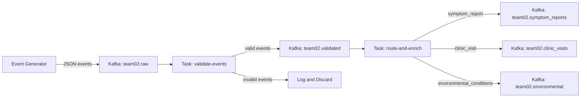

# Phase 1: Tekton Pipeline Implementation Plan

## Context

The repo is a scaffold with empty `tekton/`, `k8s/`, and `spark/` directories (only `.gitkeep` files). All Tekton manifests and documentation need to be created from scratch. The team number is **02**, so all topic names use `team02`.

**Kafka topics:**

- Input: `ds551-s26.team02.raw`
- Validated: `ds551-s26.team02.validated`
- Symptom reports: `ds551-s26.team02.symptom_reports`
- Clinic visits: `ds551-s26.team02.clinic_visits`
- Environmental: `ds551-s26.team02.environmental`

**Bootstrap server:** `my-cluster-kafka-bootstrap.ds551-2026-spring-9ab13b.svc.cluster.local:9092`

---

## Data Flow

---

## File 1: `tekton/tasks.yaml`

Two Tekton Tasks in a single multi-document YAML file (separated by `---`).

### Task 1: `validate-events`

- **Params:** `kafka-bootstrap`, `input-topic`, `output-topic`, `batch-size`
- **Image:** `python:3.11-slim`
- **Logic (Python, using `kafka-python-ng`):**
  1. Create a `KafkaConsumer` on `input-topic` with a consumer group (e.g., `team02-validate-group`), `auto_offset_reset='earliest'`, and a reasonable `consumer_timeout_ms` (e.g., 30000ms so the task eventually exits after idle).
  2. Create a `KafkaProducer` targeting the bootstrap server.
  3. For each consumed message (up to `batch-size`):
    - Parse JSON.
    - **Validate required fields:** `event_id`, `event_type`, `patient_id`, `timestamp` must all be present.
    - **Validate `event_type`:** must be one of `symptom_report`, `clinic_visit`, `environmental_conditions`.
    - **Validate `timestamp`:** must be parseable as ISO 8601 (use `datetime.fromisoformat`).
    - If valid: produce to `output-topic`.
    - If invalid: log the reason and discard.
  4. Flush producer, close consumer, print summary counts.

### Task 2: `route-and-enrich`

- **Params:** `kafka-bootstrap`, `input-topic`, `symptom-topic`, `clinic-topic`, `environmental-topic`, `team-id`, `batch-size`
- **Image:** `python:3.11-slim`
- **Logic (Python, using `kafka-python-ng`):**
  1. Create a `KafkaConsumer` on `input-topic` (validated topic) with its own consumer group, `auto_offset_reset='earliest'`, and `consumer_timeout_ms`.
  2. Create a `KafkaProducer`.
  3. For each consumed message (up to `batch-size`):
    - Parse JSON.
    - **Add enrichment fields:**
      - `team_id`: value of the `team-id` param (`"team02"`)
      - `processing_timestamp`: current UTC time in ISO 8601 (`datetime.utcnow().isoformat() + "Z"`)
      - `event_source`: `"ds551-event-generator"`
    - **Route** based on `event_type`:
      - `symptom_report` -> `symptom-topic`
      - `clinic_visit` -> `clinic-topic`
      - `environmental_conditions` -> `environmental-topic`
    - Produce enriched event to the correct topic.
  4. Flush producer, close consumer, print summary counts.

**Key implementation details:**

- Use `value_serializer=lambda v: json.dumps(v).encode('utf-8')` in the producer and `value_deserializer=lambda m: json.loads(m.decode('utf-8'))` in the consumer for clean JSON handling.
- Params are accessed in the script via Tekton's `$(params.param-name)` substitution syntax, injected directly into the Python code as string literals.

---

## File 2: `tekton/pipeline.yaml`

- **Name:** `phase1-pipeline`
- **Params:** `kafka-bootstrap`, `input-topic`, `validated-topic`, `symptom-topic`, `clinic-topic`, `environmental-topic`, `team-id`, `batch-size`
- **Tasks:**
  1. `validate` — references `validate-events` task, passes `kafka-bootstrap`, `input-topic`, `output-topic` (bound to `validated-topic`), `batch-size`
  2. `route-and-enrich` — references `route-and-enrich` task with `runAfter: [validate]`, passes `kafka-bootstrap`, `input-topic` (bound to `validated-topic`), plus all three typed topics, `team-id`, `batch-size`

---

## File 3: `tekton/pipelinerun.yaml`

- **Name:** `phase1-run`
- **pipelineRef:** `phase1-pipeline`
- **Param values:**
  - `kafka-bootstrap`: `my-cluster-kafka-bootstrap.ds551-2026-spring-9ab13b.svc.cluster.local:9092`
  - `input-topic`: `ds551-s26.team02.raw`
  - `validated-topic`: `ds551-s26.team02.validated`
  - `symptom-topic`: `ds551-s26.team02.symptom_reports`
  - `clinic-topic`: `ds551-s26.team02.clinic_visits`
  - `environmental-topic`: `ds551-s26.team02.environmental`
  - `team-id`: `team02`
  - `batch-size`: `"100"` (string, reasonable default)

---

## File 4: `tekton/README.md`

Document:

1. **Pipeline design** — two-stage pipeline (validate then route-and-enrich), why this decomposition, how params flow
2. **Deploy commands** — the exact `oc apply` and monitoring commands
3. **Verification** — how to use `kafka-console-consumer` to confirm events land in typed topics (referencing the command from [docs/kafka-tips.md](docs/kafka-tips.md))
4. **Challenges and solutions** — placeholder section to fill in after deployment

---

## Documentation Updates

- **[docs/architecture.md](docs/architecture.md):** Fill in system overview, data flow, component descriptions, technology choices (Kafka topic design, Tekton task design), and deployment info for Phase 1. Add a high-level note about planned database and analytics for later phases.
- **[docs/genai-usage.md](docs/genai-usage.md):** Log the AI usage for Phase 1 development.

