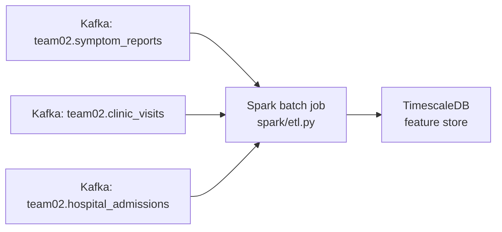

# Phase 2: Spark Analytics & Storage Implementation Plan

## Context

Phase 2 consumes the **typed topics produced by the Phase 1 Tekton pipeline** and persists **aggregated analytics** into **TimescaleDB**, which we treat as the **feature store**: time-bucketed, versioned metric tables (plus `batch_id` / `run_timestamp`) that Phase 3 can query for dashboards, alerts, and ML without re-scanning raw Kafka history.

**Course rubric:** TimescaleDB qualifies for the **+20 bonus** tier in `PHASE2-INSTRUCTIONS.md` when hypertables (and ideally continuous aggregates or documented time-series patterns) are used intentionally—not just “Postgres with a timestamp column.”

This plan mirrors the structure of [phase-1-plan.md](./phase-1-plan.md): context → data flow → reliability → observability → concrete files → testing → priorities → documentation.

**Team number:** **02** (same as Phase 1).

**Kafka bootstrap (same cluster DNS as Phase 1):** `my-cluster-kafka-bootstrap.ds551-2026-spring-9ab13b.svc.cluster.local:9092`

**Typed input topics (from this repo’s Phase 1 routing):**

| Topic | Source `event_type` |
|-------|---------------------|
| `ds551-s26.team02.symptom_reports` | `symptom_report` |
| `ds551-s26.team02.clinic_visits` | `clinic_visit` |
| `ds551-s26.team02.hospital_admissions` | `hospital_admission` |

**Expected record shape:** JSON objects that include Phase 1 base fields plus enrichment (`team_id`, `processing_timestamp`, `event_source`). Parsing code should tolerate minor schema evolution (nullable optional fields) while documenting **required** columns for each analytic.

**Event payload fields (per `INSTRUCTIONS.md`—confirm against live generator):**

| `event_type` | Payload highlights for analytics |
|--------------|----------------------------------|
| `symptom_report` | `severity`, `symptoms`, `duration_days`, `reported_via`, `available_beds` |
| `clinic_visit` | `clinic_id`, `temperature_f`, `diagnosis_code`, `follow_up_required`, `visit_type`, `available_beds`, … |
| `hospital_admission` | `hospital_id`, `severity`, `temperature_f`, `oxygen_level`, `expected_los_days`, `available_beds`, … |

Base fields such as `region` and `timestamp` come from the validated envelope and apply across types.

**Note on course docs:** `PHASE2-INSTRUCTIONS.md` sometimes illustrates `environmental` or streaming APIs; the canonical topic set for **this** pipeline is the three topics above per `tekton/README.md`. The Spark job must use **`spark.read.format("kafka")`** in **batch** mode (e.g. `read` with `startingOffsets`/`endingOffsets` or assign per topic), not `readStream`, unless the team explicitly chooses structured streaming and documents offset management.

---

## Namespace Resource Quotas (Phase 2 considerations)

Reuse the Phase 1 quota mindset: Spark driver/executor memory and database PVCs compete with Tekton and Phase 1 consumers.

| Concern | Mitigation |
|---------|------------|
| **PVC count at quota ceiling** | Database needs a PVC; ensure a slot is free before DB deploy (same as Phase 1 pre-deploy reclamation). |
| **CPU / memory** | Size Spark job requests/limits conservatively; CronJob schedule should not overlap multiple heavy runs until stable. |
| **Network to Kafka** | Use internal bootstrap DNS; job must run in a namespace/network context that resolves the Kafka service. |

**Pre-deploy checklist (additive to Phase 1):**

1. `oc describe resourcequota` — confirm CPU/memory and PVC headroom for DB + Spark job.
2. Confirm Phase 1 typed topics contain data (or document “empty topic” behavior: job completes, zero rows written).
3. After DB install, verify DNS: `timescaledb-service.<namespace>.svc.cluster.local` (or whatever Service name you define) from a debug pod if needed.

---

## Data Flow

Optional orchestration (choose one, document in `infra/`):

- **CronJob** — periodic refresh of analytics (aligns with “batch analytics layer”).
- **Job** — on-demand runs (good for grading demos).
- **Tekton Task** — consistent with Phase 1 operator workflow.

---

## Reliability (aligned with Phase 1 spirit)

| Risk | Mitigation |
|------|------------|
| **Kafka unavailable** | Fail fast with clear exit code and log line; optional retry wrapper at Job level (`backoffLimit`); document in runbook. |
| **Duplicate job runs** | Use **append** with run metadata (`batch_id`, `run_timestamp`) or **idempotent upsert** keys (e.g. `(metric_name, bucket_start)`); document semantics so Phase 3 does not double-count. |
| **Schema drift** | Defensive parsing (`try_optional` fields); log and skip malformed records with counts; do not fail entire job for a few bad rows unless unacceptable for grading rubric. |
| **DB connection failures** | JDBC/connector timeouts; fail job after N retries; runbook steps for “DB full” or “credentials rotated.” |
| **Large topics / OOM** | Restrict batch offsets (process a window), filter early, repartition judiciously; record settings in stress-test doc. |

---

## Observability (aligned with Phase 1 logging contract)

Phase 1 requires every decision log to use a **fixed prefix** plus a **JSON object** (`json.dumps`) with a defined vocabulary of keys and **reason codes**. Phase 2 follows the same pattern with prefix **`[ANALYTICS]`** (parallel to Phase 1 **`[PIPELINE]`**) so operators can grep one family of lines per subsystem.

### Structured log line format

- **Print one line per event:** `[ANALYTICS] ` + `json.dumps(payload, default=str)` (single line; no embedded newlines).
- **Required envelope keys on every payload:** `task`, `phase`, `outcome`, `reason_code`, `run_id`, `batch_id`. For successful lines where there is no failure to classify, set **`reason_code` to `null`** (Phase 1 lists codes for error paths; this keeps one consistent schema per line).
  - **`task`:** always `"spark-etl"` for the main job (or a stable submodule name if you split modules later).
  - **`phase`:** one of `preflight` | `kafka_read` | `parse` | `transform` | `db_write` | `summary` (add more only if documented in `spark/README.md`).
  - **`outcome`:** **same three values as Phase 1:** `valid` | `dlq` | `error`. Use `valid` for successful steps and accepted records; use `dlq` for records **rejected from analytics** when you log them explicitly (e.g. parse quarantine / skip-with-reason—parallel to validation DLQ semantics); use `error` for infrastructure or job-fatal failures. **Aggregate** skip counts also appear on the final health line (`skipped_count`) so operators need not ingest per-record spam.
  - **`run_id`:** unique per process execution (UUID or `BATCH_ID` + timestamp); must match env/config injected by Kubernetes.
  - **`batch_id`:** business batch identifier written to feature tables; may equal `run_id` for one-shot jobs.
- **Correlation (recommended on every line):** `k8s_pod`, `k8s_namespace`, `attempt` (from env downward API or entry script).

### Phase-1-compatible optional keys (use when relevant)

Mirror Phase 1 so cross-phase runbooks stay familiar:

| Key | When to set |
|-----|-------------|
| `event_id` | Only on **per-record** errors (rare); **omit** on aggregate lines to avoid log volume |
| `target_topic` | During `kafka_read` / parse attribution: source topic name |
| `target_table` | During `db_write`: destination Timescale table |
| `analytic_name` | During `transform` / `db_write` per analytic |

### Kafka offset and watermark contract (Phase 2 analog of Phase 1 offset logs)

Phase 1 logs `consumer.assignment()` and `consumer.position(tp)` per partition before exit. For Spark **batch** Kafka reads, log an equivalent slice for **each topic** processed:

- **`topic`**, **`partition`**, **`start_offset`**, **`end_offset`** (inclusive semantics documented in README), **`records_read`** for that slice.
- **Job-level watermarks:** `min_event_ts`, `max_event_ts` observed after parse (UTC ISO 8601), per topic or global—document which.

Emit **one `[ANALYTICS]` line per topic** at end of `kafka_read` (or immediately after read+parse) with phase `kafka_read` and outcome `valid`, plus a single **rollup line** listing all topics if log volume must stay low.

### Reason codes (extend Phase 1 taxonomy)

Reuse Phase 1 codes verbatim when the failure mode matches:

- `JSON_PARSE`
- `MISSING_FIELD:<field_name>`
- `BAD_TIMESTAMP`
- `BAD_EVENT_TYPE`
- `PRODUCE_FAILED` (not used in Phase 2 unless you produce to Kafka)
- `KAFKA_CONNECT_FAILED`
- `UNKNOWN_EVENT_TYPE_AFTER_VALIDATE` (only if parsing normalized `event_type`)

Add Phase 2–specific codes as needed:

- `KAFKA_READ_FAILED`
- `KAFKA_OFFSET_RANGE_INVALID`
- `EMPTY_TOPIC`
- `SKIPPED_RECORD` (use with `reason_detail` explaining the skip)
- `DB_WRITE_FAILED`
- `DB_CONNECT_FAILED`
- `SCHEMA_MISMATCH`

Use a **`reason_detail`** string for subtypes (truncate to ≤500 chars; **no raw payload**).

### Per-analytic `db_write` line

After each analytic persistence step, one line with: `phase`=`db_write`, `analytic_name`, `target_table`, `rows_computed`, `rows_written`, `write_mode` (`append`|`overwrite`|`upsert`), `duration_ms`, `outcome` (`valid` on success, `error` on write failure), `reason_code` (`null` on success; `DB_WRITE_FAILED` etc. on failure) and `reason_detail` when failed.

### End-of-run health summary (Phase 1 health signal parity)

Emit **exactly one** final `[ANALYTICS]` line with `phase`=`summary`, mirroring Phase 1 task health:

| Field | Purpose |
|-------|---------|
| `status` | `healthy` \| `degraded` \| `failed` |
| `total_consumed` | Total Kafka records read across topics (sum) |
| `parse_ok_count` | Successfully parsed records |
| `skipped_count` | Skipped (malformed / missing fields) |
| `error_count` | Hard errors |
| `rows_written_total` | Sum of rows written to Timescale across all analytics |
| `started_at`, `completed_at` | UTC ISO 8601 |
| `duration_ms` | Wall-clock job duration |

**Status logic (same spirit as Phase 1):**

- `failed` — uncaught exception, Kafka unreachable, or any `db_write` line with `outcome`=`error` for a required analytic.
- `degraded` — run completed but one or more non-fatal issues (e.g. empty topic, skip rate above a documented threshold, partial replay).
- `healthy` — completed with `error_count == 0` and no degraded conditions.

### PII and volume guardrails

- **Do not** log raw JSON payloads, `patient_id`, free-text symptoms, or diagnosis strings at scale. Counts and codes only; if debugging requires an ID, log a **short hash** prefix only.
- Cap **`reason_detail`** length; never log database passwords or JDBC URLs with credentials.

### Verifiable DB checks

Document exact `SELECT` queries in `spark/README.md` for graders/operators (unchanged rubric expectation).

---

## File 1: `infra/database-deployment.yaml`

- **Image:** Official **TimescaleDB** image (PostgreSQL + Timescale extension), pinned tag, compatible JDBC driver in Spark.
- **Kinds:** StatefulSet, PVC, Service, Secret (credentials reference).
- **Service:** Cluster-internal DNS matching the JDBC URL used in Spark (`jdbc:postgresql://...`).
- **Secrets:** Do not commit real passwords; use OpenShift secrets or parameterize via `oc create secret` and document in runbook.

---

## File 2: `infra/database-init.sql`

- **Extension:** `CREATE EXTENSION IF NOT EXISTS timescaledb;`
- **Feature tables:** One table per analytic output (or a small number of clearly named tables); each with a **timestamptz** column suitable for `create_hypertable` (e.g. `bucket_start` or `observed_at`).
- **Hypertables:** `SELECT create_hypertable('feature_<name>', 'bucket_start');` (chunk interval tuned after first load—document in README).
- **Indexes:** Composite indexes on `(region, bucket_start)`, `(hospital_id, bucket_start)`, `(clinic_id, bucket_start)`, `(diagnosis_code)`, matching filter patterns in Phase 3.
- **Optional (bonus narrative):** **Continuous aggregates** for the heaviest dashboards (e.g. hourly rollups from finer chunks)—refresh policy documented in runbook.
- **Comments** on tables/columns for schema documentation cross-linked in `spark/README.md`.

---

## File 3: `spark/etl.py`

- **SparkSession** configured for batch Kafka reads from all three topics with correct bootstrap and deserializer for JSON `value`.
- **Unified model:** Parse each topic to a typed DataFrame (`event_type` constant or from payload), normalize `timestamp` to timestamptz, keep `region` / keys for joins.
- **Logging:** Small helper (e.g. `log_analytics(payload: dict)`) that always prints `[ANALYTICS] ` + `json.dumps(...)` and enforces the envelope keys in the Observability section.

### Batch analytics (feature store outputs)

Six **distinct** analytics (exceeds rubric minimum); each becomes a **feature table** row set with explicit time buckets, `batch_id`, and `run_timestamp` so Phase 3 can train or serve on stable snapshots.

| # | Feature / analytic | Definition (business intent) | Primary inputs | Suggested grain (hypertable time column) |
|---|---------------------|------------------------------|----------------|----------------------------------------|
| 1 | **Regional disease severity trend** | Average `severity` and **case count** per `region` over **rolling time windows** to surface regions trending worse. | `symptom_report` (+ base `region`, `timestamp`) | e.g. 1 h buckets with Spark window functions for rolling avg/count; store `bucket_start`, `region`, `avg_severity`, `case_count`, optional rolling N-window metadata |
| 2 | **Hospital capacity pressure index** | Relate **`available_beds`** (or derived occupancy proxy) to **admission rate** per `hospital_id` to flag facilities approaching capacity **before** saturation. | `hospital_admission` | e.g. per hospital per hour: `admissions_count`, `avg_available_beds`, `pressure_index` (define formula in code + README—e.g. admissions / max(available_beds, ε)) |
| 3 | **Symptom-to-admission escalation rate** | Ratio of **admissions** to **symptom reports** per `region` (same time bucket) to detect severity worsening vs. raw case volume. | `symptom_report` + `hospital_admission` joined on `region` + time window | e.g. hourly: `region`, `symptom_count`, `admission_count`, `escalation_rate` |
| 4 | **Event volume by type over time** | Count events per **`event_type`** per hour for pipeline throughput and activity mix. | Union of parsed streams or counts per topic | hourly: `bucket_start`, `event_type`, `event_count` |
| 5 | **Average patient temperature by diagnosis code** | Mean (and optionally count) of **`temperature_f`** from **clinic_visit**, grouped by **`diagnosis_code`**, for fever–diagnosis associations. | `clinic_visit` | per diagnosis (batch snapshot dim) or per diagnosis **and** day if time evolution is desired—pick one and document |
| 6 | **Follow-up requirement rate by clinic** | Proportion of visits with **`follow_up_required = true`** per **`clinic_id`**, flagging clinics with disproportionately complex cases. | `clinic_visit` | per `clinic_id` per batch or per day: `visit_count`, `follow_up_count`, `follow_up_rate` |

**Hourly batch semantics (completeness and late data).** A batch job reads a **bounded snapshot** of Kafka (and/or a raw store) at run time—not a moving live stream—so define explicitly **which wall-clock hour** each run “closes” and how rows for `bucket_start` stay correct.

- **Close the hour after it ends (recommended default):** Schedule the CronJob to run shortly **after** the target hour finishes (e.g. at **`:05`** each hour) and aggregate the **previous** full **1 h** window by **event** `timestamp` into `bucket_start`. That avoids treating 10:00–10:59 as final while events at 10:58 are still in flight. Document timezone (prefer **UTC** for `bucket_start`) and the exact window rule (e.g. `[bucket_start, bucket_start + 1h)`).
- **Snapshot vs. stragglers:** Events whose timestamps fall in hour *H* but are **read only after** the run that first wrote hour *H* are invisible to that run; the next run must **re-include** hour *H* if you require correctness—see below.
- **Optional hardening:** A short **lookback** (recompute the last *N* hours each run) plus **upsert** on the natural key `(bucket_start, dimension keys…)` updates aggregates when late or out-of-order events arrive; **append-only** without recompute yields **stale or duplicate** hourly rows.

- **Writes:** JDBC `append` (or upsert where natural key exists) — document whether Phase 3 uses **latest batch only** or **full history** for training; if hourly buckets use upsert + lookback, say so in `spark/README.md` and the runbook.
- **Comments** in code: one block per row in the table above (required by Phase 2 rubric).

---

## File 4: `Dockerfile`

- Base image and Java version compatible with chosen PySpark version (see `PHASE2-INSTRUCTIONS.md` example; pin versions).
- Install Python deps; copy `spark/etl.py` (and any local modules).
- **Build/push** commands documented in `spark/README.md` with placeholder registry path `team02`.

---

## File 5: `infra/spark-job.yaml` or `infra/spark-cronjob.yaml`

- **Container image:** Internal registry image reference after push.
- **Env:** `KAFKA_BOOTSTRAP`, topic names (or single configmap), `DATABASE_*` connection settings, optional `BATCH_ID`.
- **Resources:** requests/limits appropriate to quota.
- **restartPolicy / backoffLimit** for Jobs; **schedule** for CronJobs—align with **Hourly batch semantics** above (e.g. run at minute 5 to close the previous clock hour, not mid-hour).
- **serviceAccountName** wired to RBAC in `infra/spark-rbac.yaml`.

---

## File 6: `spark/README.md` (R5a)

Cover all rubric bullets: analytics one-liners, data flow, expected Phase 1 schema with example JSON, manual run (`spark-submit` or `python etl.py` in container), monitoring/log expectations, full schema + sample query results.

---

## File 7: `docs/phase2-stress-test.md` (R5b)

Test matrix, environment specs, results table, bottlenecks, back-pressure and failure-mode observations—aligned with the methodology Phase 1 used for operator visibility (counters, final summaries).

---

## File 8: `docs/phase2-runbook.md` (R5c)

Startup/shutdown ordering: DB before Spark job; verification steps; troubleshooting tree (pod pending, ImagePullBackOff, Kafka DNS, DB connection refused, slow writes).

---

## Testing Strategy (parallel to Phase 1 plan)

- **Pure functions:** Extract parsing + analytic logic where possible; unit test with small in-memory DataFrames (or pandas) and fixed timestamps—**at least one fixture path per analytic** (rolling window, join ratio, pressure index edge cases like zero beds).
- **Fixtures:** Sample events matching Phase 1 enrichment under `tests/fixtures/` or `tests/conftest.py`.
- **Markers:** `@pytest.mark.unit` for fast tests; optional integration marked and gated (cluster or local Kafka).
- **Manifest sanity:** `oc apply --dry-run=client -f infra/` before merge.
- **Makefile (optional):** `make test-phase2` if Makefile already exists from Phase 1.

---

## Priority and Sequencing

- **P0:** TimescaleDB deploy + `database-init.sql` with hypertables; `spark/etl.py` for all **six** analytics + JDBC write; `Dockerfile` + one successful Job run.
- **P1:** `spark/README.md` with feature-table schemas, example `SELECT`s for each analytic, and clear **pressure_index** / **escalation_rate** formulas.
- **P2:** CronJob (or Tekton) schedule, `batch_id` semantics, structured `[ANALYTICS]` logging and end-of-run summary.
- **P3:** `docs/phase2-stress-test.md` and `docs/phase2-runbook.md` (include Timescale-specific ops: chunk health, retention); top-level README Phase 2 section.
- **P4:** Unit tests on pure transforms; continuous aggregates or compression policies if stress test shows read-path pain; Phase 3-facing “feature catalog” blurb in `architecture.md`.

---

## Documentation Updates (cross-phase consistency)

- **[docs/architecture.md](../../docs/architecture.md):** Add Phase 2 subsection—Kafka → Spark → **TimescaleDB feature store** (list feature tables and consumers: ML, dashboards, alerting).
- **[docs/genai-usage.md](../../docs/genai-usage.md):** Log Phase 2 AI-assisted work consistent with Phase 1 entry style.
- **[README.md](../../README.md):** Link Phase 2 artifacts and high-level “how to run” pointers (not duplicating full spark/README).

---

## Grading Rubric Mapping (quick reference)

| PHASE2-INSTRUCTIONS section | Primary deliverable |
|----------------------------|---------------------|
| R1 Database (50 + **20** Timescale bonus) | `infra/database-deployment.yaml`, `infra/database-init.sql` — hypertables + documented time-series / aggregate strategy |
| R2 Spark job | `spark/etl.py` |
| R3 Container | `Dockerfile` |
| R4 K8s deploy | `infra/spark-job.yaml` / `spark-cronjob.yaml`, ServiceAccount/RBAC |
| R5a–c Docs | `spark/README.md`, `docs/phase2-stress-test.md`, `docs/phase2-runbook.md` |
