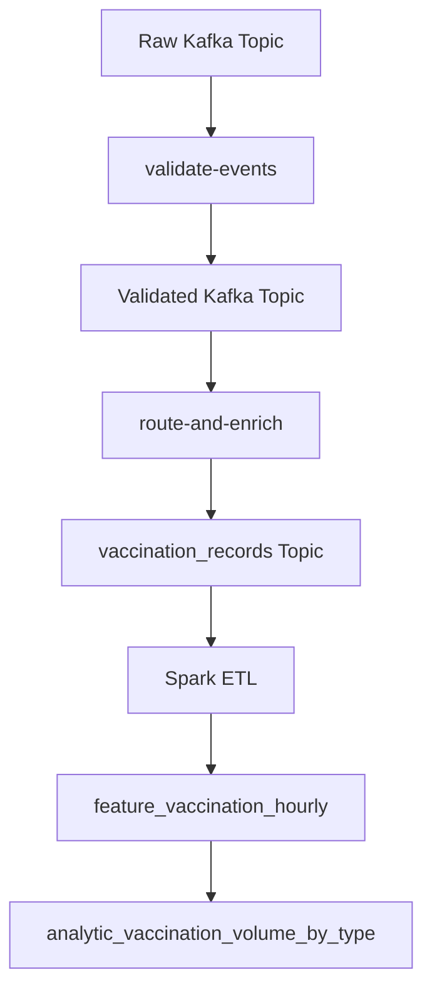

# Vaccination Change Order Plan

## Current State

`CHANGE-ORDER-CO-2026-01.md` is not implemented yet. Current behavior appears to be:

- [`tekton/tasks.yaml`](tekton/tasks.yaml) validates only base fields (`event_type`, `timestamp`, `region`) and does not understand `schema_version` or vaccination-specific required fields.
- [`tekton/tasks.yaml`](tekton/tasks.yaml) routes only `symptom_report`, `clinic_visit`, and `hospital_admission`; `vaccination_record` would pass validation but be silently dropped as an unknown type.
- [`spark/etl.py`](spark/etl.py), [`infra/database-init.sql`](infra/database-init.sql), [`infra/database-deployment.yaml`](infra/database-deployment.yaml), and [`infra/spark-job.yaml`](infra/spark-job.yaml) only know the three existing typed topics.
- Docs still show three typed topics in [`docs/phase3-architecture.md`](docs/phase3-architecture.md), [`docs/phase3-dataflow.md`](docs/phase3-dataflow.md), [`tekton/README.md`](tekton/README.md), and [`spark/README.md`](spark/README.md).

## Implementation Approach

Use a new typed topic, `ds551-s26.team02.vaccination_records`, then let Spark materialize vaccination analytics. This matches the existing architecture: raw Kafka -> validated -> typed topics -> Spark hourly facts -> Timescale views.

## Planned Changes

1. Update validation and routing in [`tekton/tasks.yaml`](tekton/tasks.yaml):
   - Keep existing event types backward-compatible.
   - For `schema_version`, accept existing event types when `schema_version` is missing or `2`; reject any present non-`2` value with a clear reason code.
   - For `vaccination_record`, require `schema_version == 2` plus `record_id`, `patient_id`, `region`, `vaccine_type`, `dose_number`, and `administered_at`.
   - Add `vaccination_record` to `TYPE_TO_TOPIC` and route failures to the existing validate/routing DLQ paths.

2. Thread the new topic through Tekton manifests:
   - Add `vaccination-topic` param to [`tekton/pipeline.yaml`](tekton/pipeline.yaml).
   - Add `vaccination-topic` values to [`tekton/pipelinerun.yaml`](tekton/pipelinerun.yaml), [`tekton/pipelinerun-continuous.yaml`](tekton/pipelinerun-continuous.yaml), and [`tekton/pipelinerun-stress-template.yaml`](tekton/pipelinerun-stress-template.yaml) if present.

3. Add Spark ingestion and analytics in [`spark/etl.py`](spark/etl.py):
   - Add default/env `TOPIC_VACCINATION`.
   - Include vaccination payload fields in `PAYLOAD_SCHEMA`.
   - Read the fourth typed topic and include it in read/parse observability.
   - Add `preliminary_vaccination_records()`.
   - Add `build_feature_vaccination_hourly()` grouped by `bucket_start`, `region`, `vaccine_type`, and `dose_number`, with counts and batch metadata.
   - Write/log `feature_vaccination_hourly` alongside existing facts.

4. Add database schema and serving view:
   - Add `feature_vaccination_hourly` to [`infra/database-init.sql`](infra/database-init.sql), including hypertable creation and useful indexes.
   - Add `v_latest_feature_vaccination_hourly` and an analytic view such as `analytic_vaccination_volume_by_type` that exposes `vaccine_type` and `dose_number`.
   - Mirror the same SQL inside the embedded ConfigMap in [`infra/database-deployment.yaml`](infra/database-deployment.yaml).

5. Update deployment/test helpers:
   - Add `TOPIC_VACCINATION` to [`infra/spark-job.yaml`](infra/spark-job.yaml).
   - Extend [`scripts/smoke-phase1-topics.sh`](scripts/smoke-phase1-topics.sh) to produce and verify at least one `vaccination_record`.
   - Extend [`scripts/smoke-phase2-db.sh`](scripts/smoke-phase2-db.sh) to produce a vaccination typed record and verify `feature_vaccination_hourly`/the analytic view.
   - Update any truncate/check lists in [`scripts/run-phase1-and-phase2.sh`](scripts/run-phase1-and-phase2.sh) to include the new table where appropriate.

6. Update docs with the decision and justification:
   - [`tekton/README.md`](tekton/README.md): validation decision, `schema_version` handling, new route, and failure behavior.
   - [`spark/README.md`](spark/README.md): new input topic, fact table, and analytic.
   - [`docs/phase3-architecture.md`](docs/phase3-architecture.md) and [`docs/phase3-dataflow.md`](docs/phase3-dataflow.md): include the fourth typed topic and vaccination data flow.
   - Optionally add a short section to [`README.md`](README.md) linking the change-order behavior.

## Verification Plan

- Static checks: parse Python files with `python -m py_compile loadgen/produce.py spark/etl.py ml/train.py ml/predict.py` as applicable; parse YAML with a local YAML loader if dependencies are available.
- Cluster smoke, when logged into OpenShift: run `scripts/smoke-phase1-topics.sh` and confirm validated plus four typed topics receive records.
- Cluster smoke for Spark/DB: run `scripts/smoke-phase2-db.sh` and confirm the new vaccination fact and analytic rows exist.
- If cluster access is unavailable, at minimum run local syntax checks and report that cluster validation remains pending.